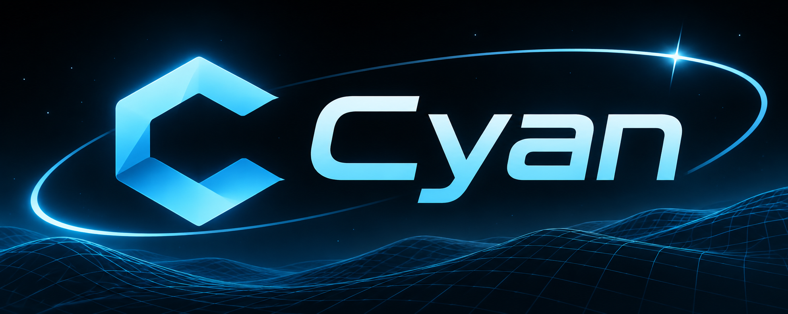

Cyan is a modern C++26 project built around three core principles: **safety, performance, and ergonomics**.

Leveraging the latest language features and novel safety mechanisms, Cyan pushes the boundaries of high-performance systems programming, delivering a robust and expressive programming experience without compromising execution speed, correctness, or developer control.

---

## Design Philosophy

### Safety

Cyan is designed with safety as a first-class concern. Memory safety, type safety, and well-defined behavior are enforced at compile-time through novel safety mechanisms and careful API design. Undefined behavior is considered a defect, never an acceptable engineering trade-off.


### Performance

No trade-off. No compromise. Just performance, engineered to be safe.

Cyan demonstrates that high-performance systems programming does not need to sacrifice memory safety, correctness, or developer control. You shouldn't have to choose between writing fast software and writing safe software. With Cyan, you can demand both.


### Ergonomics

Good software should be a pleasure to use. Cyan prioritizes clean, expressive APIs, clear error messages, and a smooth developer experience from first build to production deployment.

---

## Requirements

### Compilers

Cyan requires a compiler with C++26 support. The following compilers are guaranteed to compile:

| Compiler | Minimum Version |
|----------|-----------------|
| Clang    | 23+             |
| GCC      | 16+             |
| MSVC     | 19.52+          |

If other compilers (including older versions of the compilers listed above) happen to work with Cyan, that is great, but we won't guarantee support for those.


### Build System

| Tool  | Minimum Version |
|-------|-----------------|
| CMake | 3.30+           |

---

## Getting Started

### Dollar sign in identifiers

When using DSLs that heavily depend on macros, code commonly gets polluted with uppercase identifiers and prefixes, making it harder to distinguish regular identifiers & constructs from DSL-specific syntax.

Cyan uses the dollar sign (`$`) as a dedicated prefix for its macros, taking advantage of its ability to provide a visually distinct identifier namespace.

This approach offers several advantages:

- **Improved readability:** DSL invocations become immediately recognizable, allowing developers to distinguish them from ordinary functions, types, and other language constructs at a glance.
- **Reduced visual noise:** By avoiding uppercase identifiers and verbose prefixes, Cyan maintains a consistent naming style throughout its interfaces and implementations.
- **Reduced name collisions:** Using a distinct identifier namespace makes accidental collisions between macro names and ordinary C++ identifiers less likely.

The dollar sign is particularly suitable for this purpose because it is concise, visually distinctive, and already widely supported in identifiers by major C++ implementations. Furthermore, since macro identifiers are eliminated during preprocessing, their use of `$` does not generally introduce the same linker and target-toolchain concerns that may arise from identifiers surviving into generated object code.

Ultimately, this convention provides Cyan with a dedicated, easily recognizable namespace for its macros, reducing naming conflicts and visual ambiguity while preserving the readability and consistency expected from modern C++ code.

See [$identifiers](https://www.open-std.org/jtc1/sc22/wg21/docs/papers/2026/p4234r2.html) for more info.


### GCC `-Wshadow` Compatibility

When `$unreliable` is used, you may have to manually disable GCC shadowing in order for it to work without warnings/errors. `$gcc_ignore_shadowing` and `$gcc_restore_shadowing` are provided to help developers shortcut this.

By doing this, you will have to manually check that the rest of the parameters aren't shadowing another name in the parent scope.

We apologize for the inconvenience.

We believe GCC could benefit from more granular diagnostic controls. MSVC and Clang already allow this. We encourage the community to propose an enhancement to the GCC compiler team.


### Clone

```bash
git clone https://github.com/salonsoro/cyan.git
cd cyan
```


### Build

To integrate Cyan into your project, do the following:

```cmake
target_link_libraries(your_target PRIVATE Cyan::Cyan)
```

Then, to build with the tests enabled, invoke CMake in the following way:

```bash
cmake -B Build/{Debug|Release} -S . -G Ninja -D BUILD_TESTING=On -D CMAKE_BUILD_TYPE={Debug|Release}
cmake --build Build/{Debug|Release} --target CYAN_RUN_TESTS
```

And to build with the benchmarking enabled, invoke CMake in the following way:

```bash
cmake -B Build/{Debug|Release} -S . -G Ninja -D BUILD_BENCHMARKING=On -D CMAKE_BUILD_TYPE={Debug|Release}
cmake --build Build/{Debug|Release} --target CYAN_RUN_BENCHMARKS
```

You can also enable both testing and benchmarking:

```bash
cmake -B Build/{Debug|Release} -S . -G Ninja -D BUILD_TESTING=On -D BUILD_BENCHMARKING=On -D CMAKE_BUILD_TYPE={Debug|Release}
cmake --build Build/{Debug|Release} --target CYAN_RUN_TESTS
cmake --build Build/{Debug|Release} --target CYAN_RUN_BENCHMARKS
```

---

## Documentation

The `doc` folder contains a vanilla JavaScript & HTML5/CSS3 web platform with extensive documentation on all the features.

If something is not documented, it's not meant to be used.

---

## Testing

Every feature was validated through the CI pipeline.

When `BUILD_TESTING` is enabled, every documented feature is thoroughly tested.

The tests also showcase how the features are meant to be used.

See the `test` folder to observe the test implementations.

---

## Benchmarking

When `BUILD_BENCHMARKING` is enabled, every feature that has a potential run-time impact, will be thoroughly benchmarked.

You can open `benchmark/index.html` to analyze the generated charts.

See the `benchmark` folder to observe the benchmarking implementations.

---

## License

See [LICENSE](LICENSE.md) for details.